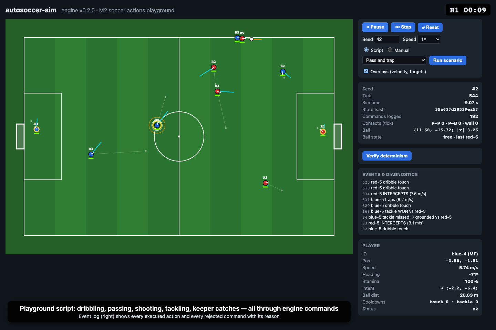

# autosoccer-sim

Deterministic 5v5 2D soccer simulation with scriptable team controllers.
Headless TypeScript engine, Bun workspace, React + PixiJS viewer.

> **Status: M2** — physical soccer actions + interactive debug inspector (on top of the M1 deterministic foundation).
> Roadmap: see the milestone issues (M1–M7).



## Quickstart

Requires **Bun 1.2.19** (pinned in `.bun-version` / `packageManager`). Node ≥ 20 is used by Vitest and Playwright.

```sh
bun install
bun run dev                       # viewer at http://127.0.0.1:5173/?seed=42
bun run headless --seed 42 --verify --out out/run-42.jsonl
bun run test                      # Vitest (Node/V8) + golden hashes under Bun/JSC
bun run typecheck
```

Viewer controls: **Space** play/pause · **.** single step · click a player to inspect (shows its
kick/tackle/catch ranges) · **Run scenario** plays a scripted demo of one action (pass, dribble,
interception, tackle, shot/goal, keeper catch & release, rejected kicks, rejected catches) ·
**Manual** mode: **WASD/arrows** move the selected player, **Shift** sprint, **E** toggle dribble,
**J** kick (Shift = hard), **K** tackle, **L** catch/release · **Verify determinism** replays the
recorded command stream and compares state hashes. The event log shows executed actions and
rejected commands with reasons.

## Layout

| Package | Purpose |
| --- | --- |
| `packages/sim-core` | Pure deterministic engine: config, seeded PRNG, deterministic math, world state, `step`, state hash, `Simulation` driver. No DOM/timers/`Math.random`. |
| `packages/controller-sdk` | Public types for command sources (full controller API lands in M4). |
| `packages/controller-runtime` | Runs command sources at 10 Hz with error isolation; playground script; keyboard helper. |
| `packages/match-runner` | Headless runner + CLI (`bun run headless`). |
| `packages/telemetry` | Run metadata, hash checkpoints, command stream → JSONL. |
| `apps/viewer` | React + PixiJS viewer; uses the same `Simulation` class as the headless runner. |
| `tests/` | Vitest suites + cross-runtime golden hashes (`tests/golden.json`). |

See [docs/architecture.md](docs/architecture.md) and [docs/simulation.md](docs/simulation.md).

## Walkthrough recording

`bun run dev` in one terminal, then `bun run walkthrough` records `docs/media/m2/walkthrough.mp4`,
a GIF preview and screenshots by driving the real viewer with Playwright (`bun run walkthrough:m1`
for the M1 recording). The script fails if an expected scenario event/rejection is missing or if
browser and headless hashes differ.
