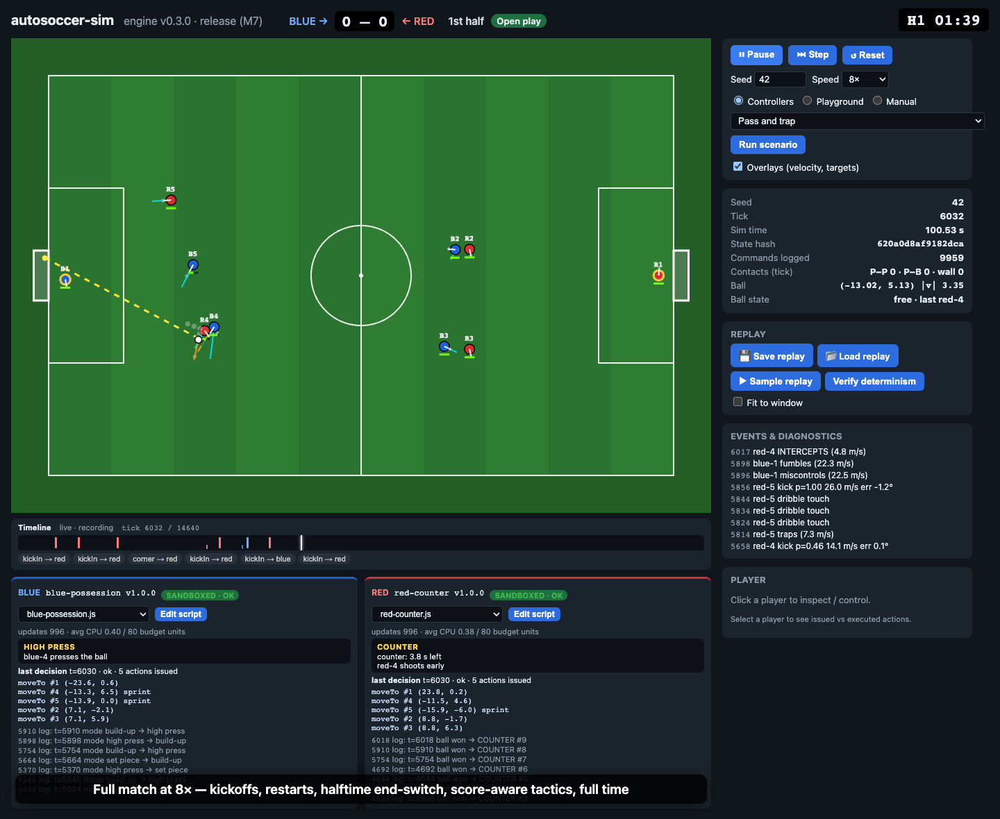

# autosoccer-sim

A deterministic 5v5 2D soccer simulator for scriptable team controllers: a headless TypeScript
engine, sandboxed JavaScript controllers, and a React + PixiJS viewer with replays. It's built so
that new controllers, including LLM-generated ones, can be written from the public docs alone.

> **Release (M7)**: tournament CLI, 1,000-seed reliability run, performance profile and a
> one-command demo. Release numbers are in [docs/release-report.md](docs/release-report.md) and
> [docs/performance.md](docs/performance.md).



## Try it

```sh
bun install
bun run demo            # viewer opens and plays Blue (possession) vs Red (counterattack)
bun run demo:replay     # viewer opens the bundled sample replay
```

Requires **Bun 1.2.19** (pinned) and Node ≥ 20. Full command list:
[docs/quickstart.md](docs/quickstart.md).

```sh
bun run dev                                    # viewer
bun run match --blue examples/controllers/blue-possession.js --red examples/controllers/red-counter.js --seed 42 --verify
bun run tournament --matches 1000 --workers 6  # seeded series, parallel; summary + replays in out/tournament
bun run replay examples/replays/blue-vs-red-sample.replay.json.gz --timeline --verify
bun run bench                                  # throughput (target ≥10× real time)
bun run test                                   # unit, regression, sandbox, replay, docs and golden-hash tests
```

## Write a controller

```js
defineController({
  name: "my-team",
  initialize(info) { this.rules = info.rules; },
  update(obs) {
    const p = Soccer.nearest(obs.teammates.filter((q) => q.role !== "GK"), obs.ball);
    return Soccer.approachAndKick(p, obs.ball, Soccer.oppGoal(obs), 0.8, this.rules);
  },
});
```

- [Tutorial: writing a controller](docs/writing-a-controller.md). Its final code is run by the tests.
- [Controller SDK reference](docs/controller-sdk.md): observations, actions, lifecycle, sandbox
  limits, helpers.
- [API coverage](docs/api-coverage.md): every action, callback, field and event mapped to examples
  and tests.
- Examples: `examples/controllers/`, including the featured
  [Blue and Red](docs/tactics.md), baselines and adversarial scripts.

## How it works

| Doc | Contents |
| --- | --- |
| [architecture.md](docs/architecture.md) | Packages, contracts, determinism rules, sandbox, replays |
| [simulation.md](docs/simulation.md) | Rules spec: units, physics, actions, match flow, restarts, fouls, clock |
| [replays.md](docs/replays.md) | Replay format, seeking, verification, viewer timeline |
| [performance.md](docs/performance.md) | Reference machine, throughput, bottlenecks |
| [troubleshooting.md](docs/troubleshooting.md) | Common problems and fixes |

Key properties:
- **Deterministic.** The same seed, config and accepted commands give identical state hashes on
  Bun, Node and Chrome. The engine uses its own correctly rounded maths, and controllers run in
  WASM with a seeded RNG.
- **Isolated.** Each controller runs in its own QuickJS/WASM sandbox with no host access, a
  16 MB heap and a deterministic CPU budget. A failing controller falls back to a built-in safe
  controller, and every restart has an engine fallback, so no controller can stall a match.
- **Replays** reproduce any match without running controllers, and verify every state hash.

## Layout

| Package | Purpose |
| --- | --- |
| `packages/sim-core` | Engine: physics, actions, match rules, hashing, invariants |
| `packages/controller-sdk` | Public API (SDK 1.2): observation and action schemas, validation, `Soccer` helpers |
| `packages/controller-runtime` | Sandbox, baseline controllers, scenarios |
| `packages/match-runner` | CLIs (match, replay, tournament, bench, soak), stats, replay building |
| `packages/telemetry` | Replay format, recorder, player and verification |
| `apps/viewer` | React + PixiJS viewer: live, scenarios, manual control, replays |
| `tests/` | Vitest suites + cross-runtime golden hashes |

## Walkthroughs

Each milestone has a captioned video recorded from the real app, in `docs/media/m1` to
`docs/media/m7`. `bun run walkthrough` re-records the release walkthrough (with `bun run dev`
running).
